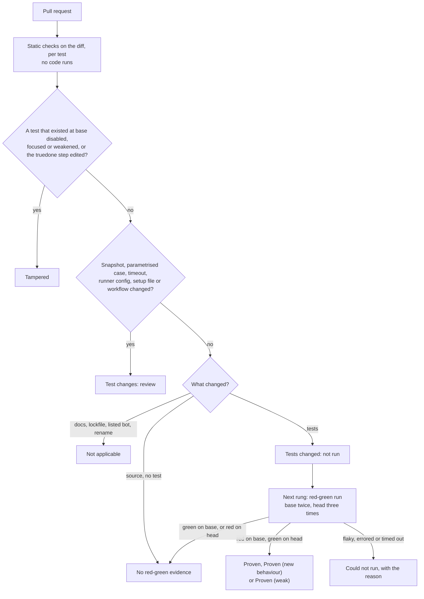

# truedone

truedone checks whether a pull request's tests prove its change: red without the change, green with it. It also flags tests that were skipped, focused or weakened. Each pull request gets one verdict, so a reviewer sees what the tests show before reading the diff. This matters most when a coding agent opened the pull request.

## How it works

The static checks read the diff and run no code. The next rung is the red-green run: each changed test runs twice on the base, without the change, and three times on the head, with it.



## Quick start

You need git and Node 22 or later. The command line is one file with no dependencies, so there is nothing to install.

1. Open a verdict in the browser: [truedone.pages.dev/Truedone/truedone-sandbox/pull/31](https://truedone.pages.dev/Truedone/truedone-sandbox/pull/31). For any public pull request, replace github.com with truedone.pages.dev in its address.

2. Clone the repository.

   ```sh
   git clone https://github.com/Truedone/truedone && cd truedone
   ```

3. Check the same pull request from the terminal. The first line it prints is `truedone: Tampered`.

   ```sh
   node packages/cli/truedone.mjs https://github.com/Truedone/truedone-sandbox/pull/31
   ```

The npm package is released, so `npx truedone <PR link>` does steps 2 and 3 in one command, with nothing cloned, and `npx truedone` on its own checks the branch you are on.

For coding agents, [llms.txt](llms.txt) says what truedone checks, how to run it and what it never does.

## Verdicts

Every pull request gets exactly one verdict. The first that applies in this table wins. When several tests ran, the best result of any test stands and the others are listed. A verdict states what was observed about the change.

| Verdict | Label | What it means | What to do next |
|---|---|---|---|
| Tampered | `truedone:tampered` | A test that existed at base is disabled, focused or weakened with nothing equivalent added, or the truedone step was removed, edited or re-pinned other than to a published release. | Restore an equivalent test, or pin the step to a published release. |
| Test changes: review | `truedone:review` | Tests moved, removed or rewritten in a way that may be legitimate, a raised timeout, or a change to the runner config, a setup file, the test script or the truedone workflow. | Confirm the test change is intended. |
| Could not run | `truedone:could-not-run` | No test reached a result. The reason is named: a missing runner, service or setup step, flaky results, an error or a timeout. | Fix the named reason and run again. |
| Proven | `truedone:yes` | A test fails on base by assertion twice, passes on head three times out of three, and runs lines the pull request changed. | Review the rest of the change as usual. |
| Proven (new behaviour) | `truedone:yes` | A test fails on base only because a function or module the pull request adds does not exist yet, passes on head three times out of three, asserts on the new code's result, and runs lines the pull request changed. | Review the rest of the change as usual. |
| Proven (weak) | `truedone:weak` | Red-green holds, but the test runs none of the changed non-test lines or asserts nothing about them. | Make the test run the changed lines and assert on them. |
| No red-green evidence | `truedone:no-evidence` | Source changed, and no test in the pull request fails without the change. | Add a test that fails before the change and passes after it. |
| Waiting for approval | `truedone:pending` | Tests changed and the repository has the truedone step, but GitHub is holding the run for a first-time contributor. The static findings are shown meanwhile. | Approve the run on GitHub. |
| Tests changed: not run | `truedone:unrun` | Tests were added or changed with nothing weakened, and no red-green run has happened. | Run the changed tests: the next rung. |
| Not applicable | none | Docs only, a lockfile or dependency change, a dependency or release bot, a CI-only change that touches no test and not the truedone step, a pure rename, or a language version 1 does not support. | Nothing. |

A large pull request that was only partly analysed gets "(partial)" after its verdict. The check conclusion is neutral by default, so truedone never blocks a merge unless the repository sets `conclusion: fail-on-tampered` in `.github/truedone.yml`.

## Ways to use it

<!-- ways: written by node tools/readme-status.mjs from packages/web/lib/release.mjs; do not edit -->
The site is live: truedone.pages.dev checks any public pull request now, and the command line, the plugin and the App are released. The action comes with the first release, planned in [docs/spec.md](docs/spec.md), each after its release's gates pass.

| Surface | Who it is for | Status |
|---|---|---|
| [truedone.pages.dev](https://truedone.pages.dev) | Anyone reading a public pull request: open `truedone.pages.dev/owner/repo/pull/n` for the static verdict in the browser, with nothing to install. Live, unannounced, since DEP-01 merged (D32). | Live |
| `npx truedone` | Developers, from the terminal: the current branch, or a pull request link. `--run` adds red-green, `--json` prints `truedone.verdict/1`, `--pr-line` prints one line for a pull request description, `init` adds four lines to `AGENTS.md` or `CLAUDE.md` that ask a coding agent to run it, and `mcp` serves the check to any agent that speaks the Model Context Protocol. | Released |
| Claude Code plugin | People working with Claude Code: a Stop hook keeps the agent from finishing when a test it changed fails, a test was weakened or disabled, or it says tests pass but has not run them since its last edit. | Released |
| GitHub App | Maintainers: one check run named `truedone` and at most one `truedone:*` label per pull request. It never runs the pull request's code. | Released |
| GitHub Action | Repositories that want red-green in CI: one `uses:` line in an existing job, nothing installed. It writes a report the GitHub App reads. | Not released yet |
<!-- ways: end -->

## Why it exists

- A green CI run says the tests pass. It does not say they fail without the change. A test that passes on the base branch and on the pull request proves nothing about the change.
- A failing test can be silenced by skipping it (`it.skip`, `@pytest.mark.skip`), by focusing another test (`.only`), or by weakening its assertion (`toBe(3)` changed to `toBeDefined()`). In a large diff these lines are easy to miss.
- Maintainers describe a flood of pull requests from coding agents. truedone gives each one a verdict and a label (none for Not applicable), so a maintainer can filter the pull request list without reading anything.

## Threat model and privacy

truedone catches careless agents and lazy shortcuts. Whoever controls a pull request also controls the test code that runs in it. The static checks flag changes to runner config and setup files, but the pull request side is not a security boundary. A weakness in truedone itself goes to the [security policy](SECURITY.md).

The site, the CLI and the plugin read from GitHub and keep nothing on a server. The app keeps one setting per installation and deletes it within 24 hours of an uninstall. Labels already set stay after uninstall. The [privacy note](docs/privacy.md) says what each part reads and stores, and for how long; the [terms](docs/terms.md) cover the hosted parts.

## Status

<!-- status: written by node tools/readme-status.mjs from the contract and main; do not edit -->
Released: docs/releases/w4.md says "Decision: GO".

At main 44fd80ca55b5 (2026-10-19), 133 of the 173 tasks in the signed contract, [proofline.json](proofline.json), are on main:

- truedone.pages.dev: 14 of 17 (WEB-01, WEB-02, WEB-04, WEB-05, WEB-06, WEB-07, WEB-08, WEB-09, WEB-10, WEB-11, WEB-12, WEB-13, WEB-14, WEB-15).
- `npx truedone`: 6 of 9 (CLI-02, CLI-01, CLI-03, CLI-05, CLI-07, CLI-09).
- Claude Code plugin: 10 of 13 (PLG-00, PLG-01, PLG-02, PLG-04, PLG-05, PLG-07, PLG-08, PLG-09, PLG-10, PLG-12).
- GitHub App: 32 of 32 (APP-02, APP-01, APP-07, APP-08, APP-09, APP-10, APP-11, APP-12, APP-13, APP-14, APP-15, APP-16, APP-17, APP-18, APP-19, APP-20, APP-21, APP-22, APP-23, APP-24, APP-25, APP-26, APP-27, APP-28, APP-29, APP-30, APP-31, APP-32, APP-03, APP-05, APP-06, APP-04).
- GitHub Action: 3 of 4 (ACT-01, ACT-02, ACT-03).
- The engine they share: 19 of 22 (CORE-01, CORE-02, CORE-03, CORE-05, CORE-04, CORE-06, CORE-07, CORE-08, CORE-09, CORE-10, CORE-11, CORE-12, RUN-01, RUN-02, RUN-03, RUN-06, RUN-07, RUN-04, JUDGE-01).
- Measurement gates and the index: 1 of 11 (GATE-06).
- Releases: 8 of 15 (REL-01, REL-02, REL-P1, REL-P2, REL-P3, REL-P5, REL-P4, REL-W4).
- Repository, CI, deploys and docs: 40 of 50 (OPS-04, OPS-01, OPS-03A, OPS-02, OPS-03B, ENG-01, BENCH-01, BENCH-02, COLLECT-01, SPK-02, SEC-01, SEC-02, SEC-03, SEC-04, GUARD-01, COLLECT-02, DEP-01, DEP-02, DOM-01, AGENT-01, MCP-01, AGENT-02, OPS-05, REPO-01, REPO-02, REPO-03, ORG-01, MET-01, MET-02, ORG-02, MAP-01, MAP-02, TEST-01, DOC-00, README-01, README-02, README-03, OPS-09, OPS-10, OPS-11).
<!-- status: end -->

## Contributing

Every change lands as one task from the signed contract in `proofline.json`, with a test that fails without the change and passes with it. Start with [CONTRIBUTING.md](CONTRIBUTING.md). `npm test` runs every test with `node:test`; two of them also need Python 3 with pytest. The full specification is [docs/spec.md](docs/spec.md), and [docs/DEPENDENCY-MAP.md](docs/DEPENDENCY-MAP.md) shows how the files depend on each other. truedone is licensed under [Apache-2.0](LICENSE), and everyone taking part follows the [code of conduct](CODE_OF_CONDUCT.md).
