# Dependency map

Everything in this repository is connected (D28). Each node below is a set of files; it lists the nodes it must **update** and the nodes to **review**. An update edge means the downstream node changes in the same change; a review edge means it is read, and changed if the change reaches it. `node tools/depmap-check.mjs` enforces the map on every task: it fails on a tracked file that no node covers, a node that covers nothing (unless it is planned), a planned node that already has files, a change that skips an update edge, and a node or edge missing from this page. For every changed node it prints the nodes to review downstream and upstream.

When you add a file, add it to a node here in the same change; when a planned node gets its first file, drop "planned". A planned update target is skipped until it has a file.

## The map

Thick arrows are update edges; dotted arrows are review edges.

```mermaid
flowchart TD
  readme["readme<br/>the front page"]
  spec["spec<br/>the specification the contract cites"]
  requirements["requirements<br/>the requirement ids"]
  contract["contract<br/>the signed contract and its owner key"]
  fragment["fragment<br/>PL-PV01, for proofline"]
  agents["agents<br/>the rules for agents"]
  signers["signers<br/>the owner signing key"]
  depmap["depmap<br/>this map"]
  checks["checks<br/>the map, design and README checks"]
  repo_config["repo-config<br/>ignore and editor settings"]
  tools["tools<br/>build, CI gate and test tools"]
  root["root<br/>manifests and licence"]
  community["community<br/>contributing, conduct, notice, changelog, templates"]
  core["core<br/>analyse() and judge(), pure functions"]
  core_run["core-run<br/>the red-green runner"]
  core_test["core-test<br/>core tests and fixtures"]
  bundles["bundles<br/>the built single files"]
  web["web<br/>truedone.pages.dev"]
  cli["cli<br/>npx truedone and the plugin"]
  app["app<br/>the GitHub App"]
  action["action<br/>the CI step"]
  corpus["corpus<br/>the sample and the gate scripts"]
  bench["bench<br/>latency and detection benches"]
  metrics["metrics<br/>public metrics, the profile"]
  misses["misses<br/>the wrong-verdict collector"]
  github["github<br/>CI workflows and CODEOWNERS"]
  gates["gates<br/>gate records and review sheets"]
  index["index<br/>the weekly index"]
  ops["ops<br/>the owner ops records"]
  releases["releases<br/>release decisions"]
  spikes["spikes<br/>spike records"]
  policy["policy<br/>the security policy"]
  notices["notices<br/>the privacy and terms notes"]
  legal_pages["legal-pages<br/>the privacy and terms pages, generated"]
  design["design<br/>section documents and the master schematic"]
  reviews["reviews<br/>review records"]
  spec ==>|update| design
  requirements ==>|update| contract
  core ==>|update| bundles
  notices ==>|update| legal_pages
  core_run ==>|update| bundles
  readme -.->|review| design
  spec -.->|review| requirements
  spec -.->|review| contract
  requirements -.->|review| spec
  contract -.->|review| spec
  contract -.->|review| requirements
  fragment -.->|review| contract
  agents -.->|review| contract
  signers -.->|review| github
  checks -.->|review| contract
  checks -.->|review| depmap
  tools -.->|review| github
  root -.->|review| readme
  root -.->|review| tools
  community -.->|review| readme
  core -.->|review| core_test
  core -.->|review| spec
  core_run -.->|review| core_test
  core_run -.->|review| spec
  core_test -.->|review| core
  bundles -.->|review| web
  bundles -.->|review| cli
  bundles -.->|review| app
  bundles -.->|review| action
  web -.->|review| readme
  web -.->|review| design
  web -.->|review| app
  cli -.->|review| readme
  cli -.->|review| design
  app -.->|review| readme
  app -.->|review| design
  action -.->|review| readme
  action -.->|review| design
  corpus -.->|review| gates
  corpus -.->|review| index
  bench -.->|review| readme
  metrics -.->|review| readme
  misses -.->|review| metrics
  misses -.->|review| bench
  github -.->|review| contract
  gates -.->|review| readme
  gates -.->|review| releases
  index -.->|review| readme
  releases -.->|review| readme
  spikes -.->|review| spec
  policy -.->|review| readme
  policy -.->|review| web
  notices -.->|review| readme
  notices -.->|review| web
  design -.->|review| readme
  reviews -.->|review| readme
```



## Nodes

| Node | What it holds | Paths | Must update | Review | Status |
|---|---|---|---|---|---|
| `readme` | the front page | `README.md` |   | `design` | live |
| `spec` | the specification the contract cites | `docs/spec.md` | `design` | `requirements`, `contract` | live |
| `requirements` | the requirement ids | `REQUIREMENTS.md` | `contract` | `spec` | live |
| `contract` | the signed contract and its owner key | `proofline.json`, `proofline.json.sig`, `guard/**` |   | `spec`, `requirements` | live |
| `fragment` | PL-PV01, for proofline | `docs/contracts/**` |   | `contract` | live |
| `agents` | the rules for agents | `AGENTS.md` |   | `contract` | live |
| `signers` | the owner signing key | `.github/allowed_signers` |   | `github` | live |
| `depmap` | this map | `docs/DEPENDENCY-MAP.md` |   |   | live |
| `checks` | the map, design and README checks | `tools/depmap-check.mjs`, `tools/docs-check.mjs`, `tools/readme-check.mjs` |   | `contract`, `depmap` | live |
| `repo-config` | ignore and editor settings | `.gitignore`, `.editorconfig` |   |   | live |
| `tools` | build, CI gate and test tools | `tools/*.mjs`, `tools/test/**` |   | `github` | live |
| `root` | manifests and licence | `package.json`, `package-lock.json`, `LICENSE`, `packages/*/package.json`, `packages/*/README.md` |   | `readme`, `tools` | live |
| `community` | contributing, conduct, notice, changelog, templates | `CONTRIBUTING.md`, `CODE_OF_CONDUCT.md`, `NOTICE`, `CHANGELOG.md`, `.github/ISSUE_TEMPLATE/**`, `.github/PULL_REQUEST_TEMPLATE.md` |   | `readme` | live |
| `core` | analyse() and judge(), pure functions | `packages/core/src/**`, `packages/core/package.json`, `packages/core/README.md` | `bundles` | `core-test`, `spec` | live |
| `core-run` | the red-green runner | `packages/core/run/**` | `bundles` | `core-test`, `spec` | live |
| `core-test` | core tests and fixtures | `packages/core/test/**` |   | `core` | live |
| `bundles` | the built single files | `packages/core/core.mjs`, `packages/web/core.mjs`, `packages/cli/truedone.mjs`, `packages/cli/plugin/hooks/stop.mjs`, `packages/action/dist/index.mjs` |   | `web`, `cli`, `app`, `action` | live |
| `web` | truedone.pages.dev | `packages/web/**` |   | `readme`, `design`, `app` | live |
| `cli` | npx truedone and the plugin | `packages/cli/**`, `.claude-plugin/**` |   | `readme`, `design` | live |
| `app` | the GitHub App | `packages/app/**` |   | `readme`, `design` | live |
| `action` | the CI step | `packages/action/**` |   | `readme`, `design` | live |
| `corpus` | the sample and the gate scripts | `tools/corpus/**` |   | `gates`, `index` | planned |
| `bench` | latency and detection benches | `tools/bench/**`, `docs/bench/**` |   | `readme` | live |
| `metrics` | public metrics, the profile | `tools/metrics/**`, `docs/metrics/**`, `docs/org/**` |   | `readme` | live |
| `misses` | the wrong-verdict collector | `tools/misses/**` |   | `metrics`, `bench` | live |
| `github` | CI workflows and CODEOWNERS | `.github/workflows/**`, `.github/CODEOWNERS` |   | `contract` | live |
| `gates` | gate records and review sheets | `docs/gates/**` |   | `readme`, `releases` | live |
| `index` | the weekly index | `docs/index/**` |   | `readme` | planned |
| `ops` | the owner ops records | `docs/ops/**` |   |   | live |
| `releases` | release decisions | `docs/releases/**` |   | `readme` | live |
| `spikes` | spike records | `docs/spikes/**`, `docs/plugin-hooks.md` |   | `spec` | live |
| `policy` | the security policy | `SECURITY.md` |   | `readme`, `web` | live |
| `notices` | the privacy and terms notes | `docs/privacy.md`, `docs/terms.md` | `legal-pages` | `readme`, `web` | live |
| `legal-pages` | the privacy and terms pages, generated by `tools/build-legal.mjs` from the notes | `packages/web/privacy.html`, `packages/web/terms.html` |   |   | live |
| `design` | section documents and the master schematic | `docs/design/**` |   | `readme` | live |
| `reviews` | review records | `docs/reviews/**` |   | `readme` | planned |

## The edges, as the check reads them

```json depmap
{
  "nodes": {
    "readme": {"paths": ["README.md"], "update": [], "review": ["design"]},
    "spec": {"paths": ["docs/spec.md"], "update": ["design"], "review": ["requirements", "contract"]},
    "requirements": {"paths": ["REQUIREMENTS.md"], "update": ["contract"], "review": ["spec"]},
    "contract": {"paths": ["proofline.json", "proofline.json.sig", "guard/**"], "update": [], "review": ["spec", "requirements"]},
    "fragment": {"paths": ["docs/contracts/**"], "update": [], "review": ["contract"]},
    "agents": {"paths": ["AGENTS.md"], "update": [], "review": ["contract"]},
    "signers": {"paths": [".github/allowed_signers"], "update": [], "review": ["github"]},
    "depmap": {"paths": ["docs/DEPENDENCY-MAP.md"], "update": [], "review": []},
    "checks": {"paths": ["tools/depmap-check.mjs", "tools/docs-check.mjs", "tools/readme-check.mjs"], "update": [], "review": ["contract", "depmap"]},
    "repo-config": {"paths": [".gitignore", ".editorconfig"], "update": [], "review": []},
    "tools": {"paths": ["tools/*.mjs", "tools/test/**"], "update": [], "review": ["github"]},
    "root": {"paths": ["package.json", "package-lock.json", "LICENSE", "packages/*/package.json", "packages/*/README.md"], "update": [], "review": ["readme", "tools"]},
    "community": {"paths": ["CONTRIBUTING.md", "CODE_OF_CONDUCT.md", "NOTICE", "CHANGELOG.md", ".github/ISSUE_TEMPLATE/**", ".github/PULL_REQUEST_TEMPLATE.md"], "update": [], "review": ["readme"]},
    "core": {"paths": ["packages/core/src/**", "packages/core/package.json", "packages/core/README.md"], "update": ["bundles"], "review": ["core-test", "spec"]},
    "core-run": {"paths": ["packages/core/run/**"], "update": ["bundles"], "review": ["core-test", "spec"]},
    "core-test": {"paths": ["packages/core/test/**"], "update": [], "review": ["core"]},
    "bundles": {"paths": ["packages/core/core.mjs", "packages/web/core.mjs", "packages/cli/truedone.mjs", "packages/cli/plugin/hooks/stop.mjs", "packages/action/dist/index.mjs"], "update": [], "review": ["web", "cli", "app", "action"]},
    "web": {"paths": ["packages/web/**"], "update": [], "review": ["readme", "design", "app"]},
    "cli": {"paths": ["packages/cli/**", ".claude-plugin/**"], "update": [], "review": ["readme", "design"]},
    "app": {"paths": ["packages/app/**"], "update": [], "review": ["readme", "design"]},
    "action": {"paths": ["packages/action/**"], "update": [], "review": ["readme", "design"]},
    "corpus": {"planned": true, "paths": ["tools/corpus/**"], "update": [], "review": ["gates", "index"]},
    "bench": {"paths": ["tools/bench/**", "docs/bench/**"], "update": [], "review": ["readme"]},
    "metrics": {"paths": ["tools/metrics/**", "docs/metrics/**", "docs/org/**"], "update": [], "review": ["readme"]},
    "misses": {"paths": ["tools/misses/**"], "update": [], "review": ["metrics", "bench"]},
    "github": {"paths": [".github/workflows/**", ".github/CODEOWNERS"], "update": [], "review": ["contract"]},
    "gates": {"paths": ["docs/gates/**"], "update": [], "review": ["readme", "releases"]},
    "index": {"planned": true, "paths": ["docs/index/**"], "update": [], "review": ["readme"]},
    "ops": {"paths": ["docs/ops/**"], "update": [], "review": []},
    "releases": {"paths": ["docs/releases/**"], "update": [], "review": ["readme"]},
    "spikes": {"paths": ["docs/spikes/**", "docs/plugin-hooks.md"], "update": [], "review": ["spec"]},
    "policy": {"paths": ["SECURITY.md"], "update": [], "review": ["readme", "web"]},
    "notices": {"paths": ["docs/privacy.md", "docs/terms.md"], "update": ["legal-pages"], "review": ["readme", "web"]},
    "legal-pages": {"paths": ["packages/web/privacy.html", "packages/web/terms.html"], "update": [], "review": []},
    "design": {"paths": ["docs/design/**"], "update": [], "review": ["readme"]},
    "reviews": {"planned": true, "paths": ["docs/reviews/**"], "update": [], "review": ["readme"]}
  }
}
```
