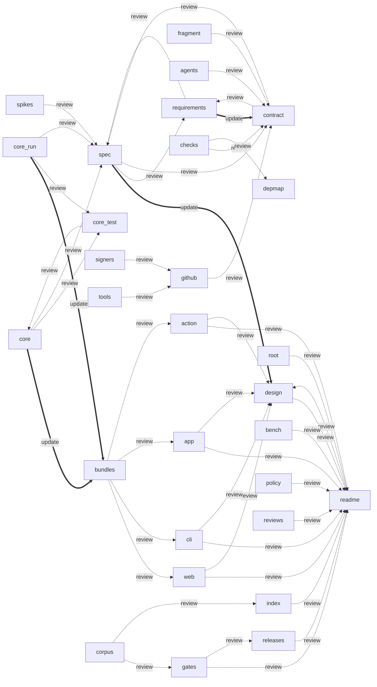

# Dependency map

Every file in this repository belongs to a node below (D28). A node lists the nodes it must **update** in the same change, which `node tools/depmap-check.mjs` enforces on every task, and the nodes to **review**, which the check prints upstream and downstream. A node marked planned has no file yet; the change that adds its first file removes "planned". Change this map in the same change as the files.



```json depmap
{
  "nodes": {
    "readme": {
      "paths": [
        "README.md"
      ],
      "update": [],
      "review": [
        "design"
      ]
    },
    "spec": {
      "paths": [
        "docs/spec.md"
      ],
      "update": [
        "design"
      ],
      "review": [
        "requirements",
        "contract"
      ]
    },
    "requirements": {
      "paths": [
        "REQUIREMENTS.md"
      ],
      "update": [
        "contract"
      ],
      "review": [
        "spec"
      ]
    },
    "contract": {
      "paths": [
        "proofline.json",
        "proofline.json.sig",
        "guard/**"
      ],
      "update": [],
      "review": [
        "spec",
        "requirements"
      ]
    },
    "fragment": {
      "paths": [
        "docs/contracts/**"
      ],
      "update": [],
      "review": [
        "contract"
      ]
    },
    "agents": {
      "paths": [
        "AGENTS.md"
      ],
      "update": [],
      "review": [
        "contract"
      ]
    },
    "signers": {
      "paths": [
        ".github/allowed_signers"
      ],
      "update": [],
      "review": [
        "github"
      ]
    },
    "depmap": {
      "paths": [
        "docs/DEPENDENCY-MAP.md"
      ],
      "update": [],
      "review": []
    },
    "checks": {
      "paths": [
        "tools/depmap-check.mjs",
        "tools/docs-check.mjs",
        "tools/readme-check.mjs"
      ],
      "update": [],
      "review": [
        "contract",
        "depmap"
      ]
    },
    "repo-config": {
      "paths": [
        ".gitignore",
        ".editorconfig"
      ],
      "update": [],
      "review": []
    },
    "tools": {
      "paths": [
        "tools/*.mjs",
        "tools/test/**"
      ],
      "update": [],
      "review": [
        "github"
      ]
    },
    "root": {
      "planned": true,
      "paths": [
        "package.json",
        "LICENSE",
        "NOTICE",
        "packages/*/package.json",
        "packages/*/README.md"
      ],
      "update": [],
      "review": [
        "readme"
      ]
    },
    "core": {
      "planned": true,
      "paths": [
        "packages/core/src/**",
        "packages/core/package.json",
        "packages/core/README.md"
      ],
      "update": [
        "bundles"
      ],
      "review": [
        "core-test",
        "spec"
      ]
    },
    "core-run": {
      "planned": true,
      "paths": [
        "packages/core/run/**"
      ],
      "update": [
        "bundles"
      ],
      "review": [
        "core-test",
        "spec"
      ]
    },
    "core-test": {
      "planned": true,
      "paths": [
        "packages/core/test/**"
      ],
      "update": [],
      "review": [
        "core"
      ]
    },
    "bundles": {
      "planned": true,
      "paths": [
        "packages/core/core.mjs",
        "packages/web/core.mjs",
        "packages/cli/truedone.mjs",
        "packages/cli/plugin/hooks/stop.mjs",
        "packages/action/dist/index.mjs"
      ],
      "update": [],
      "review": [
        "web",
        "cli",
        "app",
        "action"
      ]
    },
    "web": {
      "planned": true,
      "paths": [
        "packages/web/**"
      ],
      "update": [],
      "review": [
        "readme",
        "design"
      ]
    },
    "cli": {
      "planned": true,
      "paths": [
        "packages/cli/**",
        ".claude-plugin/**"
      ],
      "update": [],
      "review": [
        "readme",
        "design"
      ]
    },
    "app": {
      "planned": true,
      "paths": [
        "packages/app/**"
      ],
      "update": [],
      "review": [
        "readme",
        "design"
      ]
    },
    "action": {
      "planned": true,
      "paths": [
        "packages/action/**"
      ],
      "update": [],
      "review": [
        "readme",
        "design"
      ]
    },
    "corpus": {
      "planned": true,
      "paths": [
        "tools/corpus/**"
      ],
      "update": [],
      "review": [
        "gates",
        "index"
      ]
    },
    "bench": {
      "planned": true,
      "paths": [
        "tools/bench/**",
        "docs/bench/**"
      ],
      "update": [],
      "review": [
        "readme"
      ]
    },
    "github": {
      "planned": true,
      "paths": [
        ".github/workflows/**",
        ".github/CODEOWNERS"
      ],
      "update": [],
      "review": [
        "contract"
      ]
    },
    "gates": {
      "planned": true,
      "paths": [
        "docs/gates/**"
      ],
      "update": [],
      "review": [
        "readme",
        "releases"
      ]
    },
    "index": {
      "planned": true,
      "paths": [
        "docs/index/**"
      ],
      "update": [],
      "review": [
        "readme"
      ]
    },
    "ops": {
      "paths": [
        "docs/ops/**"
      ],
      "update": [],
      "review": []
    },
    "releases": {
      "planned": true,
      "paths": [
        "docs/releases/**"
      ],
      "update": [],
      "review": [
        "readme"
      ]
    },
    "spikes": {
      "planned": true,
      "paths": [
        "docs/spikes/**",
        "docs/plugin-hooks.md"
      ],
      "update": [],
      "review": [
        "spec"
      ]
    },
    "policy": {
      "planned": true,
      "paths": [
        "SECURITY.md",
        "docs/privacy.md",
        "docs/terms.md"
      ],
      "update": [],
      "review": [
        "readme"
      ]
    },
    "design": {
      "planned": true,
      "paths": [
        "docs/design/**"
      ],
      "update": [],
      "review": [
        "readme"
      ]
    },
    "reviews": {
      "planned": true,
      "paths": [
        "docs/reviews/**"
      ],
      "update": [],
      "review": [
        "readme"
      ]
    }
  }
}
```
