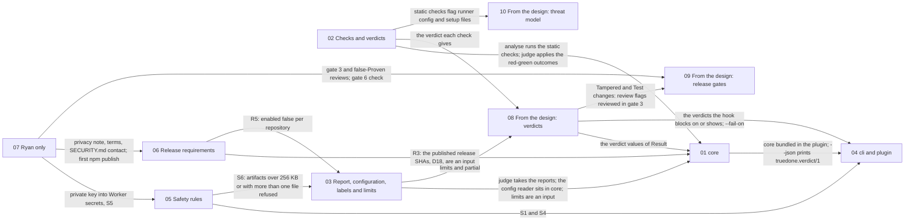

# Design master schematic

One document per section of [docs/spec.md](../spec.md), the decisions and the requirements list excepted. Each node below is one document; an arrow means the section at its tail supplies something the section at its head uses, as the spec states it.

## Documents

- [01 core](01-core.md)
- [02 Checks and verdicts](02-checks-and-verdicts.md)
- [03 Report, configuration, labels and limits](03-report-configuration-labels-and-limits.md)
- [04 cli and plugin](04-cli-and-plugin.md)
- [05 Safety rules](05-safety-rules.md)
- [06 Release requirements](06-release-requirements.md)
- [07 Ryan only](07-ryan-only.md)
- [08 From the design: verdicts](08-design-verdicts.md)
- [09 From the design: release gates](09-design-release-gates.md)
- [10 From the design: threat model](10-design-threat-model.md)
