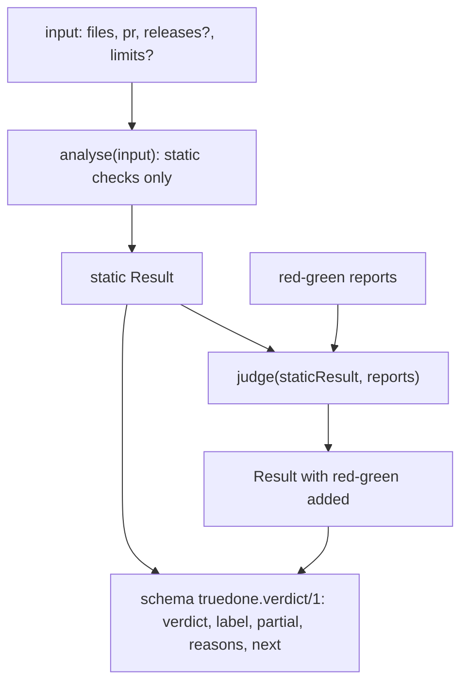
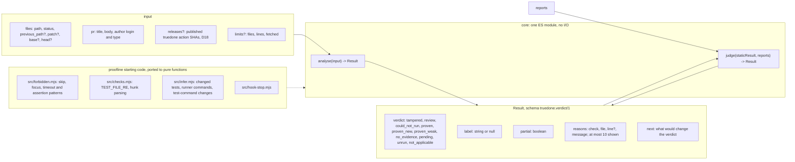

# 01 core

Source section: core

core is two pure functions in one ES module, with no I/O. `analyse(input)` runs the static checks only and returns a Result. `judge(staticResult, reports)` takes that static result and adds the red-green reports.

The input holds the PR's files in the shape of the GitHub PR files API (path, status, previous path, patch, and base and head contents), the PR's title, body and author, and two optional fields: the published truedone action SHAs (D18) and the limits on files, lines and fetched files. Base and head contents are given only for test, setup, runner-config and workflow files.

The Result has the schema `truedone.verdict/1`. It holds one verdict, a label or null, a `partial` flag, the reasons (one line each, at most 10 shown) and `next`, which says what would change the verdict.

The starting code is in proofline: `src/forbidden.mjs`, `src/checks.mjs`, `src/infer.mjs` and `src/hook-stop.mjs`. That code reads git and the file system, so it is ported to pure functions, not copied. proofline has no runtime dependencies today.

## Flow

## Schematic

[Back to the master schematic](00-master.md)
