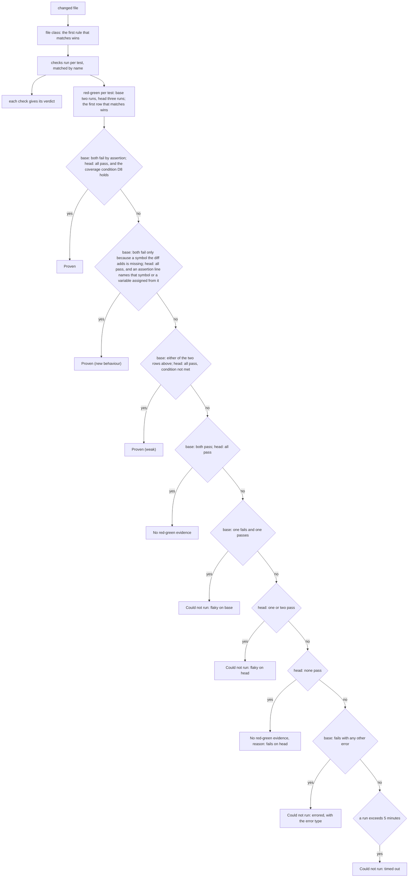
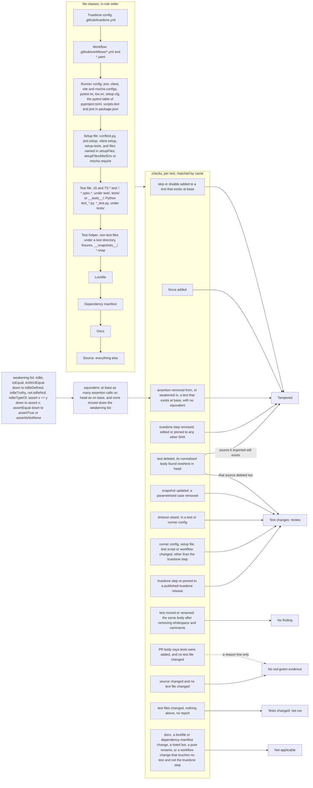

# 02 Checks and verdicts

Source section: Checks and verdicts

Each changed file gets one class, and the first rule that matches wins: Truedone config, Workflow, Runner config, Setup file, Test file, Test helper, Lockfile, Dependency manifest, Docs, and Source for everything else. JavaScript config files are never evaluated: defaults apply and the summary says so. Custom `testMatch` or `python_files` patterns are read from JSON, INI and TOML configs.

Checks run per test, matched by name. They replace proofline's net count of assertion lines per file. Each check gives a verdict: Tampered, Test changes: review, No red-green evidence, Tests changed: not run, Not applicable, or no finding for a test moved or renamed. A PR body that says tests were added, with no test file changed, is a reason line on No red-green evidence and never a verdict alone.

Equivalent means the same test on head has at least as many assertion calls as on base, and none moved down the weakening list.

Red-green runs each test twice on base and three times on head. The first row of the outcome table that matches gives the result for that test. Failing by assertion means `AssertionError`, Node's `ERR_ASSERTION`, or a jest or vitest matcher failure. A missing symbol means `ImportError`, `ModuleNotFoundError`, `AttributeError`, `ReferenceError` or "is not a function", naming a symbol the diff adds. Any other import, collection or setup error is never red.

## Flow

## Schematic

[Back to the master schematic](00-master.md)
