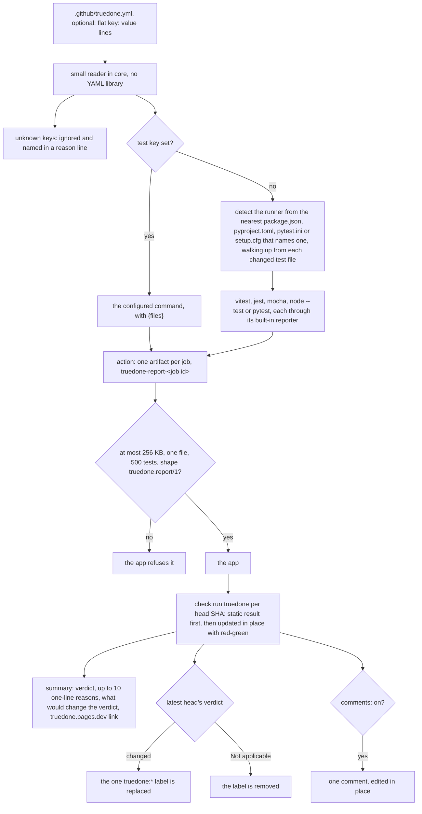

# 03 Report, configuration, labels and limits

Source section: Report, configuration, labels and limits

**Report.** The action sends the app one artifact per job, named `truedone-report-<job id>`, of at most 256 KB, one file and 500 tests. The app refuses anything larger or of another shape. The report has the schema `truedone.report/1`: the head, checked-out and base SHAs, the truedone version, the runner and the job; per test, the file, the name, two base results, three head results, the coverage condition, whether it asserts on a new symbol, and the duration; a `could_not_run` reason with detail, or null; and a `truncated` flag.

**Runners.** Version 1 detects vitest, jest, mocha, `node --test` and pytest. Each writes its result through its own built-in reporter. Detection reads the `package.json`, `pyproject.toml`, `pytest.ini` and `setup.cfg` in each directory from a changed test file up to the repository root, and takes the nearest one that names a runner.

**Configuration.** `.github/truedone.yml` is optional. It holds flat `key: value` lines only, read by a small reader in core with no YAML library. The keys are `test`, `comments`, `conclusion`, `ignore` and `enabled`. Unknown keys are ignored and named in a reason line.

**Labels, check run and comment.** There is one check run named `truedone` per head SHA: the static result is posted first, then updated in place with red-green. A PR carries exactly one `truedone:*` label at any time. It is replaced when the latest head's verdict changes, and removed for Not applicable. Labels are created on first use, with fixed colours and descriptions under GitHub's 100-character limit, ending in `truedone.pages.dev/why`. The comment is posted only when `comments: on`, and there is one, edited in place. The summary gives the verdict, up to 10 one-line reasons, what would change the verdict, and the truedone.pages.dev link.

**Limits.** Static: up to 300 changed files, 20,000 changed lines and 100 fetched files. Beyond that, files are analysed in path order up to the limit and the verdict carries "(partial)". A partial PR is never Not applicable. Red-green: up to 50 changed tests, 5 minutes a run and 20 minutes for the whole step.

## Flow

## Schematic

```mermaid
flowchart LR
  subgraph REPORT["report, schema truedone.report/1"]
    direction TB
    H["head_sha, checked_out_sha, base_sha, truedone_version, runner, job"]
    T["tests: file, name, base x2, head x3, condition, asserts_new_symbol, duration_ms"]
    B["base result: fail:assertion, fail:missing, fail:error, pass or timeout"]
    HD["head result: pass, fail or timeout"]
    CO["condition: lines, imports or none"]
    CNR["could_not_run: null, or reason runner, service, setup, timeout, flaky or error, with detail"]
    TR["truncated: boolean"]
    T --- B
    T --- HD
    T --- CO
  end
  subgraph RUNNERS["runners in version 1 and their reporters"]
    direction TB
    J["jest --json"]
    VI["vitest --reporter=json"]
    MO["mocha --reporter json"]
    NT["node --test --test-reporter=junit"]
    PY["pytest --junitxml"]
  end
  subgraph CONFIG["keys in .github/truedone.yml"]
    direction TB
    K1["test: a command with {files}; default detected"]
    K2["comments: off or on; default off"]
    K3["conclusion: neutral or fail-on-tampered; default neutral"]
    K4["ignore: comma-separated globs; default none"]
    K5["enabled: true or false; default true"]
  end
  subgraph GITHUB["what the app sets on GitHub"]
    direction TB
    CR["check run truedone, one per head SHA"]
    LB["one truedone:* label; descriptions under 100 characters, ending in truedone.pages.dev/why"]
    CM["one comment, only when comments: on"]
  end
  subgraph LIMITS["limits"]
    direction TB
    LS["static: 300 changed files, 20,000 changed lines, 100 fetched files; beyond that, path order up to the limit and (partial)"]
    LR["red-green: 50 changed tests, 5 minutes a run, 20 minutes for the whole step"]
  end
  RUNNERS --> REPORT
  CONFIG --> RUNNERS
  REPORT -->|one artifact per job, at most 256 KB, one file, 500 tests| GITHUB
  CONFIG --> GITHUB
  LS -.->|the verdict carries partial, never Not applicable| CR
  LR -.->|bounds the red-green step| RUNNERS
```

[Back to the master schematic](00-master.md)
