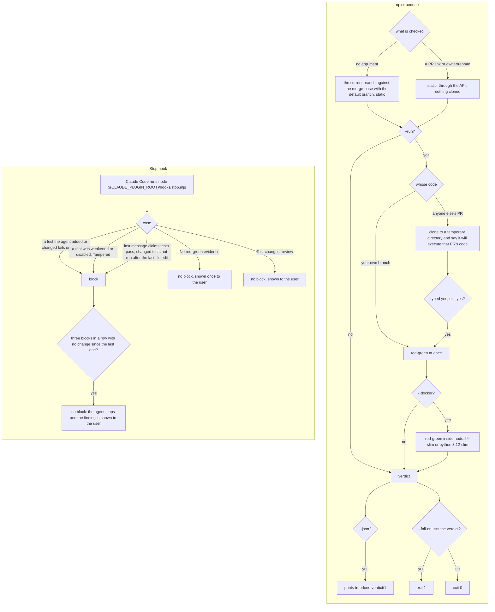
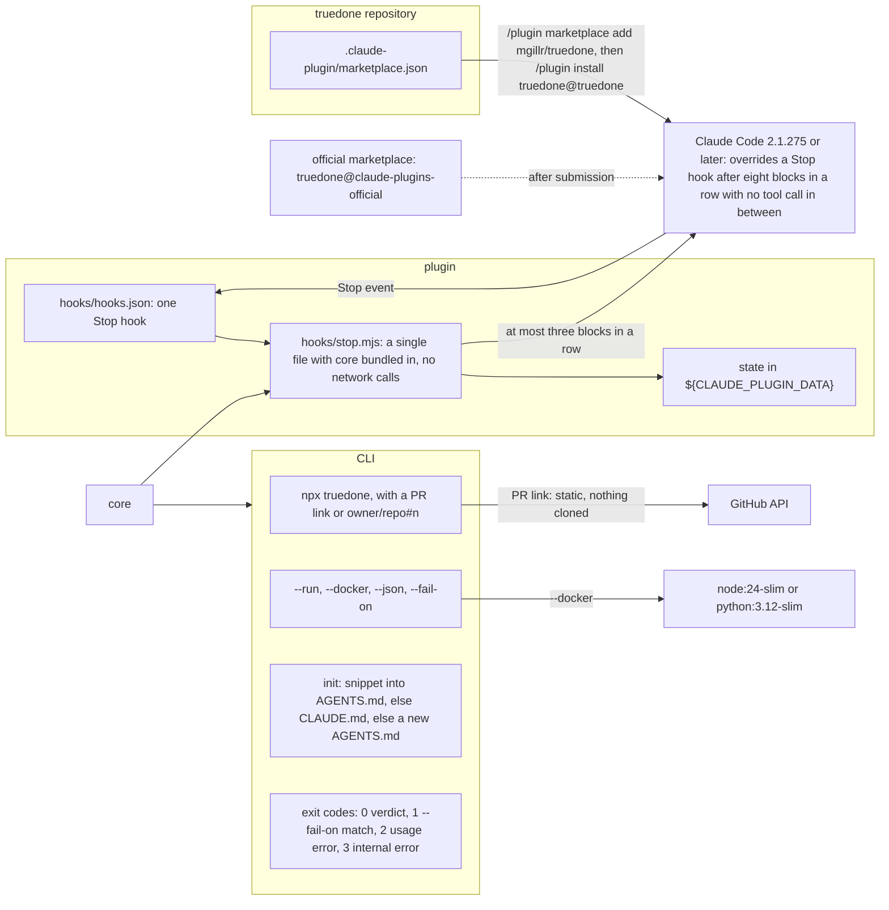

# 04 cli and plugin

Source section: cli and plugin

**The CLI.** `npx truedone` checks the current branch against the merge-base with the default branch, statically. Given a PR link or `owner/repo#n`, it checks statically through the API and clones nothing. `--run` adds red-green: on your own branch it runs at once; on anyone else's PR it clones to a temporary directory, says it will execute that PR's code, and waits for a typed `yes` or `--yes`. `--docker` runs red-green inside `node:24-slim` or `python:3.12-slim`. `--json` prints `truedone.verdict/1`. `--fail-on <verdicts>` exits 1 when the verdict is in the list. `init` adds the snippet to `AGENTS.md` if it exists, else to `CLAUDE.md` if it exists, else creates `AGENTS.md`; it never edits existing lines and prints what it wrote. Exit codes: 0 when a verdict is produced, 1 when `--fail-on` matches, 2 for a usage error, 3 for an internal error.

**The plugin.** A Claude Code plugin with one Stop hook, declared in `hooks/hooks.json` and run as `node "${CLAUDE_PLUGIN_ROOT}/hooks/stop.mjs"`: a single file with core bundled in. It makes no network calls and keeps any state in `${CLAUDE_PLUGIN_DATA}`. The truedone repository holds `.claude-plugin/marketplace.json`, so `/plugin marketplace add mgillr/truedone`, then `/plugin install truedone@truedone`, installs it (Claude Code 2.1.275 or later). It is also submitted to the official marketplace, after which `/plugin install truedone@claude-plugins-official` works.

The hook blocks when a test the agent added or changed fails on a fresh run, when a test was weakened or disabled (Tampered), or when the agent's last message claims tests pass and the changed tests were not run after its last file edit, judged from the transcript's tool-call order. It does not block for No red-green evidence (shown once to the user) or Test changes: review (shown to the user). After three blocks in a row with no change since the last one, it does not block: the agent stops and the finding is shown to the user. That limit of three sits under Claude Code's override of a Stop hook after eight blocks in a row with no tool call in between.

Before the plugin task starts, lane-b reads the hooks reference for the Stop hook's input fields (the transcript path), its exit-code behaviour and its user-visible message field, and records them in the task. If there is no user-visible field, a finding that does not block goes through one block whose reason asks the agent to state it, and never a second.

## Flow

## Schematic

[Back to the master schematic](00-master.md)
