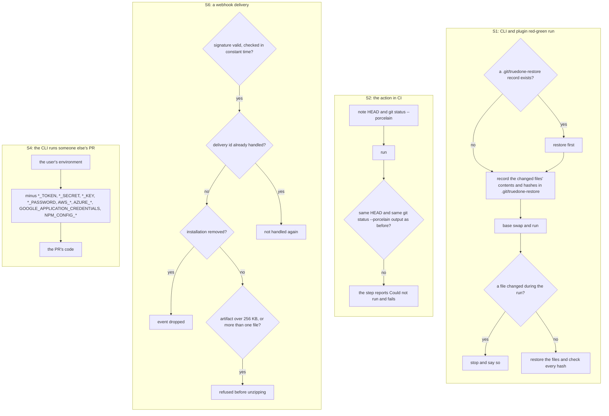
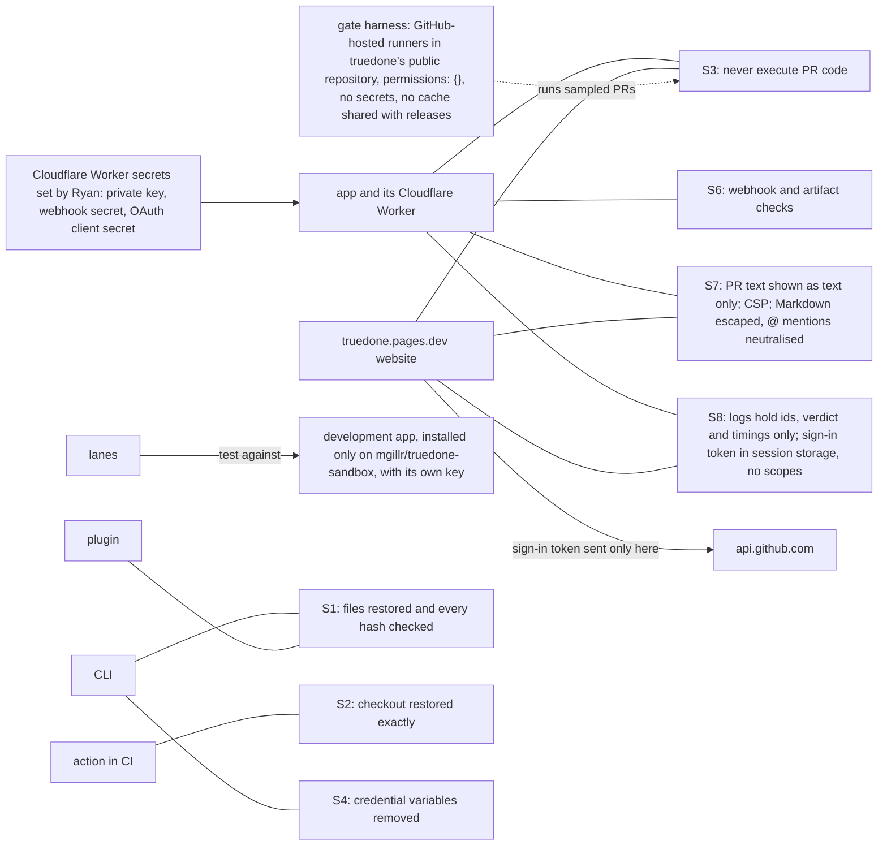

# 05 Safety rules

Source section: Safety rules

- **S1.** The CLI and plugin never leave the user's files changed. Before the base swap they record the changed files' contents and hashes in `.git/truedone-restore`. Afterwards they restore the files and check every hash. A run that finds the record restores first. If a file changed during the run, they stop and say so.
- **S2.** In CI the action restores the checkout exactly: the same HEAD and the same `git status --porcelain` output as before. Otherwise the step reports Could not run and fails.
- **S3.** truedone's app and website never execute PR code. The gate harness runs sampled PRs on GitHub-hosted runners in truedone's public repository, with `permissions: {}`, no secrets and no cache shared with releases.
- **S4.** When the CLI runs someone else's PR, the PR's code gets the environment minus every variable ending in `_TOKEN`, `_SECRET`, `_KEY` or `_PASSWORD`, and minus `AWS_*`, `AZURE_*`, `GOOGLE_APPLICATION_CREDENTIALS` and `NPM_CONFIG_*`.
- **S5.** The app's private key, webhook secret and OAuth client secret exist only as Cloudflare Worker secrets that Ryan sets, never in the repository or on an agent machine. Lanes test against a separate development app installed only on `mgillr/truedone-sandbox`, with its own key.
- **S6.** Webhooks: the signature is checked in constant time, each delivery id is handled once, and events for removed installations are dropped. Artifacts over 256 KB, or holding more than one file, are refused before unzipping.
- **S7.** PR titles, bodies and paths are shown as text only. truedone.pages.dev uses no `innerHTML` for them and sets a content security policy that allows scripts from itself, and connections only to itself (the precomputed pages), `api.github.com`, raw.githubusercontent.com (D24) and the token exchange https://truedone-exchange.ledgerguard-global.workers.dev (D26, WEB-02). Check summaries and comments escape Markdown and neutralise `@` mentions taken from PR content.
- **S8.** The Worker logs installation id, repository id, PR number, verdict and timings, never diff content, file contents or PR text. The sign-in token stays in the visitor's session storage, requests no scopes, and is sent only to `api.github.com`.

## Flow

## Schematic

[Back to the master schematic](00-master.md)
