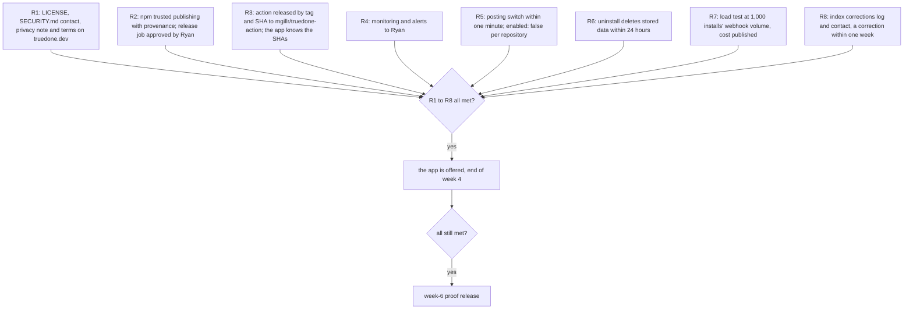
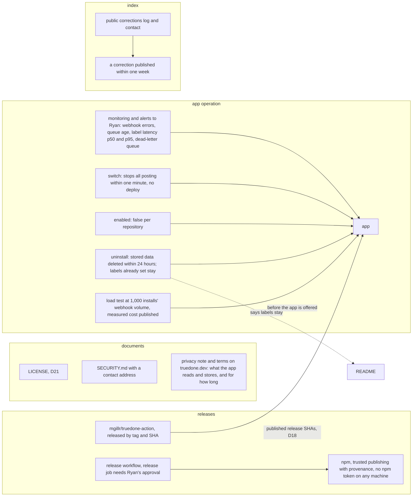

# 06 Release requirements

Source section: Release requirements

All eight requirements are met before the app is offered at the end of week 4, and still met at the week-6 proof release.

- **R1.** `LICENSE` (D21), `SECURITY.md` with a contact address, and a privacy note and terms on truedone.dev that say what the app reads and stores, and for how long.
- **R2.** npm releases go through trusted publishing from the release workflow, with provenance. There is no npm token on any machine. The release job needs Ryan's approval.
- **R3.** The action is released by tag and SHA to `mgillr/truedone-action`. The app knows the published release SHAs (D18).
- **R4.** Monitoring and alerts to Ryan: webhook errors, queue age, label latency p50 and p95, and a dead-letter queue.
- **R5.** A switch that stops all posting within one minute without a deploy, and `enabled: false` per repository.
- **R6.** On uninstall, stored data for that installation is deleted within 24 hours. Labels already set stay, and the README says so.
- **R7.** A load test at 1,000 installs' webhook volume before the app is offered, with the measured cost published.
- **R8.** The index has a public corrections log and a contact, and a correction is published within one week.

## Flow

## Schematic

[Back to the master schematic](00-master.md)
