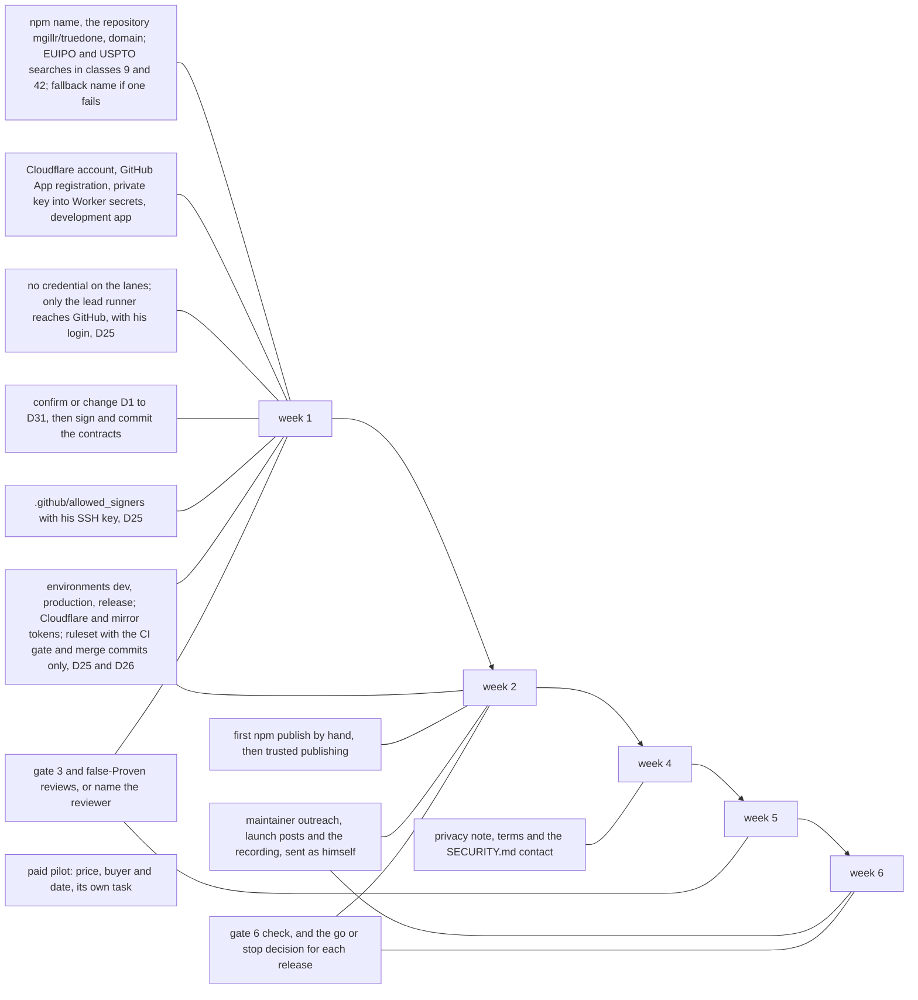
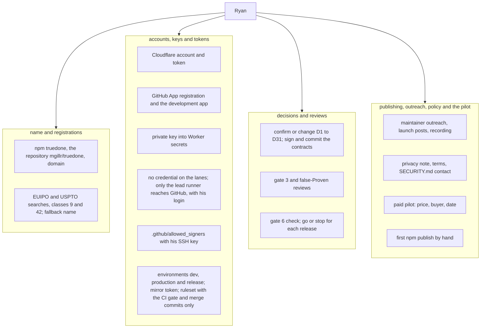

# 07 Ryan only

Source section: Ryan only

These items are Ryan's alone, each with the week it falls in.

- Week 1: register npm `truedone`, the repository mgillr/truedone and the domain; run the EUIPO and USPTO searches in classes 9 and 42, and choose the fallback name if one fails.
- Week 1: the Cloudflare account, the GitHub App registration, the private key into Worker secrets, and the development app.
- Week 1: no credential on the lanes: only the lead runner reaches GitHub, with his login (D25).
- Week 1: confirm or change D1 to D31, then sign and commit the contracts.
- Week 1: `.github/allowed_signers` with his SSH key (D25).
- Weeks 1 and 2: the environments dev, production and release, the Cloudflare token, the mirror token, and the ruleset with the CI gate and merge commits only (D25, D26).
- Weeks 1 and 5: the gate 3 and false-Proven reviews, or naming the reviewer.
- Week 2: the first npm publish by hand, then trusted publishing for every later release.
- Weeks 2 to 6: maintainer outreach, the launch posts and the recording, sent as himself.
- Weeks 2 and 6: the gate 6 check, and the go or stop decision for each release.
- Week 4: the privacy note, the terms and the `SECURITY.md` contact.
- Its own task: the paid pilot, with price, buyer and date.

## Flow

## Schematic

[Back to the master schematic](00-master.md)
