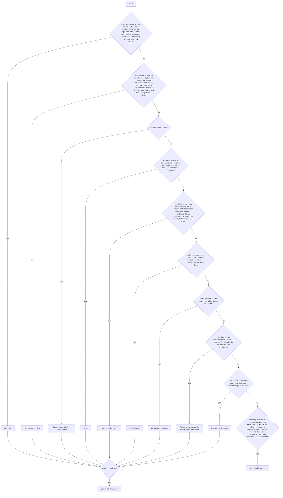
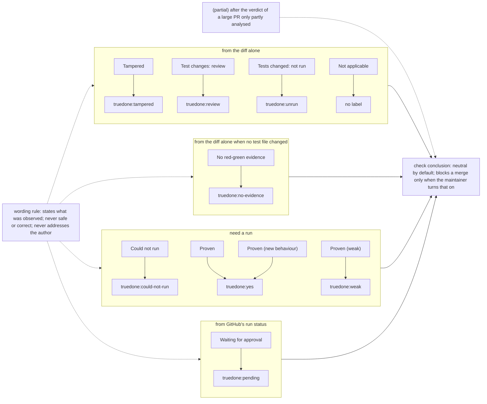

# 08 Verdicts

Source section: From the design: verdicts

Every PR gets exactly one verdict, chosen by precedence. Every verdict except Not applicable sets a label, so a maintainer can filter the PR list without reading anything. The check conclusion is neutral by default, so it never blocks a merge unless the maintainer turns that on. A large PR that was only partly analysed gets "(partial)" after its verdict.

The ten verdicts, highest precedence first, with their labels: Tampered (`truedone:tampered`), Test changes: review (`truedone:review`), Could not run (`truedone:could-not-run`), Proven (`truedone:yes`), Proven (new behaviour) (`truedone:yes`), Proven (weak) (`truedone:weak`), No red-green evidence (`truedone:no-evidence`), Waiting for approval (`truedone:pending`), Tests changed: not run (`truedone:unrun`), and Not applicable, which has no label. Tampered, Test changes: review, Tests changed: not run and Not applicable come from the diff alone. No red-green evidence does when no test file changed. Waiting for approval comes from GitHub's run status. The others need a run.

Could not run applies only when no test reached a result. When several tests ran, the best result of any test stands and the others are listed.

A verdict states what was observed about the change. It never says "safe" or "correct" and never addresses the author.

What to do next, which is also the Result's `next`, and what truedone.pages.dev/why shows for each label:

- Tampered: Restore an equivalent test, or pin the step to a published release.
- Test changes: review: Confirm the test change is intended.
- Could not run: Fix the named reason and run again.
- Proven: Review the rest of the change as usual.
- Proven (new behaviour): Review the rest of the change as usual.
- Proven (weak): Make the test run the changed lines and assert on them.
- No red-green evidence: Add a test that fails before the change and passes after it.
- Waiting for approval: Approve the run on GitHub.
- Tests changed: not run: Run the changed tests: the next rung.
- Not applicable: Nothing.

## Flow

## Schematic

[Back to the master schematic](00-master.md)
