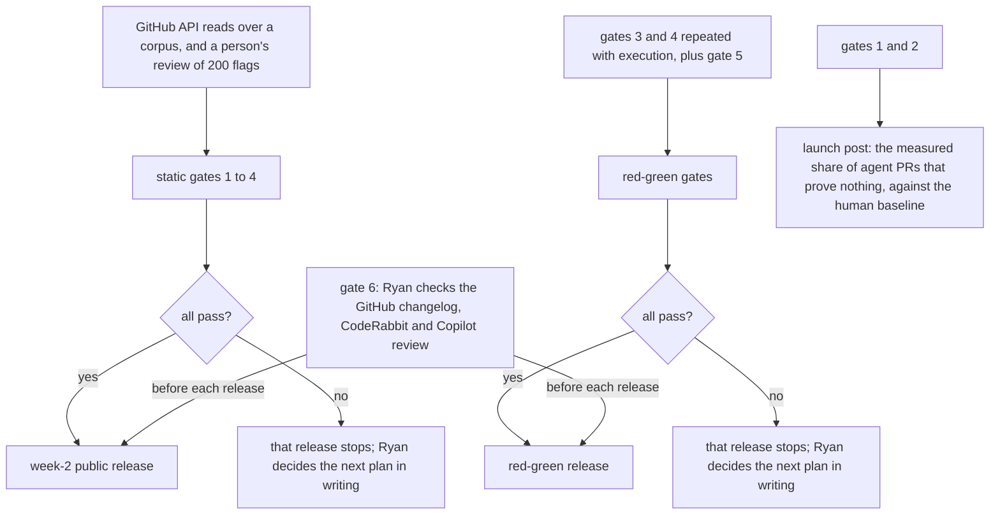
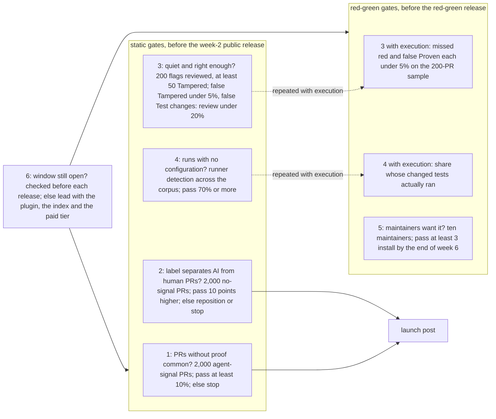

# 09 Release gates

Source section: From the design: release gates

There are two sets of gates. The static gates, 1 to 4, need only GitHub API reads over a corpus and a person's review of 200 flags, about two days of work, and must pass before the week-2 public release. The red-green gates, 3 and 4 repeated with execution plus gate 5, must pass before the red-green release. A failed gate stops the release it guards. Each gate names the next plan if it fails, and Ryan decides it in writing.

1. Are PRs without proof common? The share of 2,000 public PRs with an agent signal that change source and no test, from one 60-day window in JavaScript, TypeScript and Python repositories (sample spec: D12). Red-green later, on a sample of 200. Pass: at least 10%. If it fails: stop.
2. Does the label separate AI PRs from human ones? The same measurement on 2,000 PRs with no agent signal from the same repositories, window and mix of open, closed and merged, with PRs opened before 2024 reported beside it. Pass: the agent PRs' share is at least 10 points higher. If it fails: reposition as a general quality check, or stop.
3. Is it quiet and right enough to keep? Ryan, or a person he names who did not build the checks, reviews 200 Tampered and Test-changes flags (at least 50 Tampered) on PRs maintainers merged. With red-green, missed red and false Proven on the 200-PR sample. Pass: false Tampered under 5%, false Test changes: review under 20%, missed red and false Proven each under 5%. If it fails: fix before releasing, and never release at 5% or above.
4. Does it run with no configuration? Static: runner detection across the corpus repositories. With red-green: the share whose changed tests actually ran. Pass: 70% or more with no config line. If it fails: add runners or a one-line config.
5. Do maintainers want it? Ten maintainers of projects that have described AI-PR load in public, picked by Ryan from docs/gates/gate5-candidates.tsv with a link to each statement, get a precomputed truedone.pages.dev page of their own last 20 PRs in week 2, and the app when it is live at the end of week 4. Pass: at least 3 install the app by the end of week 6. If it fails: rethink the app and keep the other rungs.
6. Is the window still open? Ryan checks the watch list before each release: the GitHub changelog, Copilot code review, CodeRabbit, Test Ratchet, Skylos, tamperguard, checkwash and donegate, and any GitHub guidance that recommends a test failing on the pre-change behaviour. Pass: none ships a red-green or test-tamper check first. If it fails: lead with the plugin, the index and the paid tier.

Gates 1 and 2 also produce the launch post: the measured share of agent PRs that prove nothing, against the human baseline.

Before the proof release, a public demonstration on Truedone/truedone-sandbox runs the published npm version and the action's published tag on one pull request per case, every verdict among them, and checks each truedone check and label against docs/demo/expected.json; docs/demo.md publishes it (DEMO-01). ACT-04's 20 seeded pull requests and APP-06's smoke can reuse these cases.

The preview, 0.1.0, ships before these gates (D35): the command line on npm, the action on Truedone/truedone-action, the production App made public, and the plugin from this repository's marketplace, each labelled preview and none announced. A part counts as released only after a walk of its install path from a fresh home gives the expected verdict on the sandbox's demonstration pull requests, and only then does its entry in packages/web/lib/release.mjs flip. The gates above still guard the launch: the announcement, the index, the marketplace submission and the second wave.

## Flow

## Schematic

[Back to the master schematic](00-master.md)
