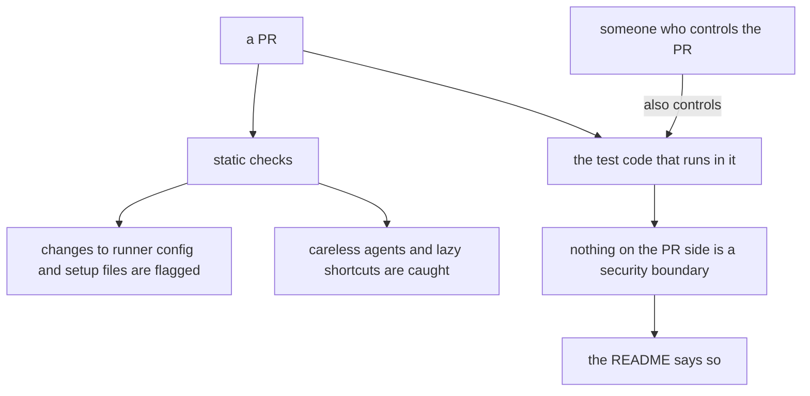
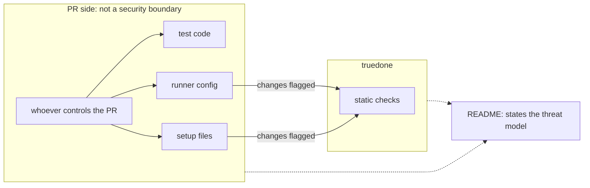

# 10 Threat model

Source section: From the design: threat model

The threat model is stated in the README. truedone catches careless agents and lazy shortcuts, which is the flood maintainers describe. Someone who controls a PR also controls the test code that runs in it. The static checks flag changes to runner config and setup files, but nothing on the PR side is a security boundary, and the README says so.

## Flow

## Schematic

[Back to the master schematic](00-master.md)
